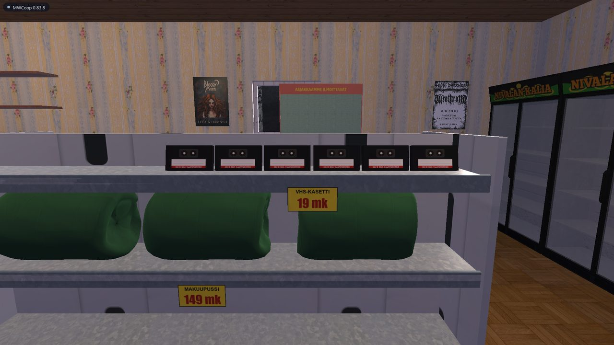
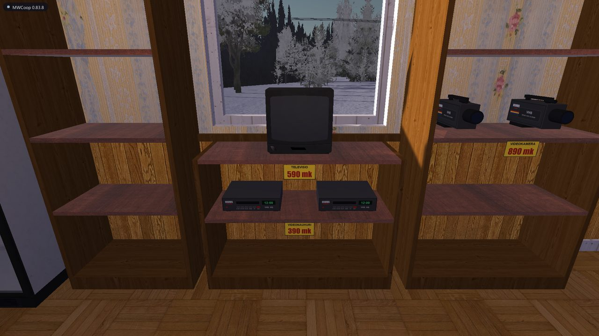
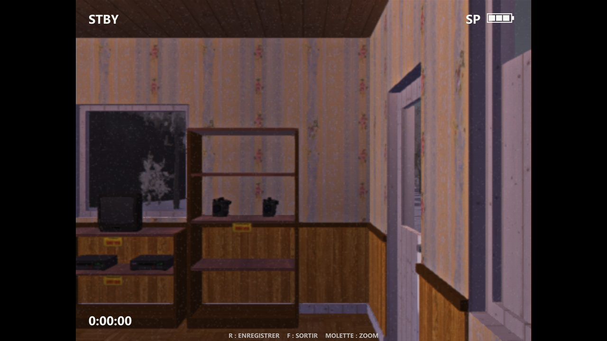
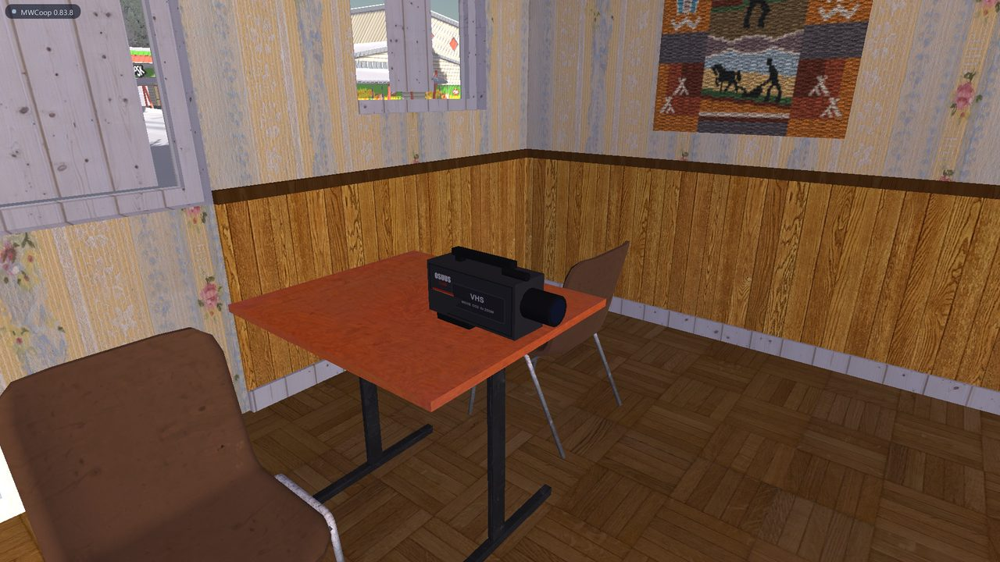
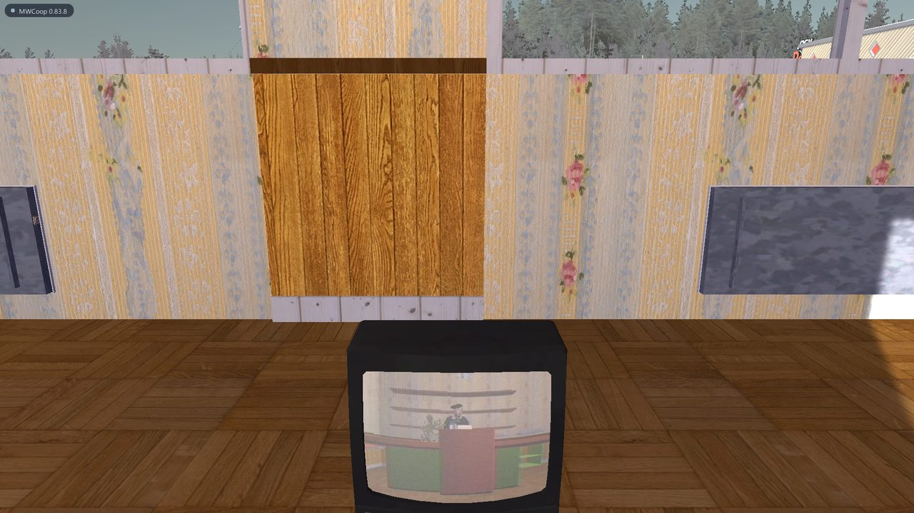

# Video corner guide / Guide du coin vidéo

*Since MWCoop 0.84.0 — [Français plus bas](#français)*

Film your co-op adventures with a 90s VHS camcorder — or put your own videos on a tape — and watch them together on a TV, with sound.

## English

### 1. Go to the shop

The **OSUUSKAUPPA 𝔰21** shop is in Peräjärvi, south-west of the PSK crossroads (Teimo's store), along the small road, next to the Museum of Corsica. Click the door handle to open the door.

In the shop:

| Item | Price | Where |
|---|---|---|
| VHS tape | 19 mk | top shelf of the white gondola, in the middle of the shop |
| VCR | 390 mk | wooden shelf on the left wall, middle unit |
| Television | 590 mk | on top of that same shelf |
| Camcorder | 890 mk | wooden shelf on the left wall, right-hand unit |




### 2. Buy

1. Look at an item on the shelf and **left click**: you take one (it disappears from the shelf). **Right click** puts it back.
2. Look at the **till** on the counter: the total shows up. **Click** to pay.
3. Your purchases come in an OSUUSKAUPPA **shopping bag** on the counter. Pick it up like any object.
4. Look at the bag (or hold it in your hand), anywhere — at the shop, at home, next to your car: **F** (short press) takes one item out, **hold F** takes everything out. An empty bag disappears.

To film and watch, you need: **a camcorder, a tape, a VCR and a TV**. You can also use a TV of the game instead of buying one (the TV at home, in the prison, at the retirement home, at Jokke's).

### 3. Put a tape in the camcorder

1. Put the camcorder down (on a table, on the floor).
2. Pick up a tape.
3. Look at the camcorder and **left click**: the tape goes in.

To take the tape out: look at the camcorder (not in your hand) and **hold F**.

### 4. Film

**Camcorder in your hand:** press **F** to raise it to your eye, like the ice scraper. The others see you holding it to your eye, and you look through the viewfinder (4:3 VHS picture, REC, tape counter, battery). Then:

- **Left click** = start filming. Left click again = pause, again = resume... as often as you like: it stays the same take.
- **Mouse wheel** = zoom.
- **F** = lower the camcorder back into your hands: the take ends, is added to the tape and sent to the others.
- Then a **right click** throws it, like any object of the game. (A right click while looking through the viewfinder also lowers it.)

Camcorder in your hand without the viewfinder: **R** = start / stop recording.



**Camcorder set down** (on a tripod-like spot: a table, a shelf...):

- Look at it and press **R** = start recording, **R** again = stop. It films straight ahead. **Hold F** to take the tape out.
- When you drop it, it turns to face where you were looking. Handy to film yourself and your friends.



Good to know:

- A red light blinks on the camcorder while it records — everybody sees it.
- The sound recorded is what **you** hear: the game around you, the music, the cars, and the other players' voices (voice chat, louder when they're close). **Your own voice** is recorded too when you talk (V) while filming — if the camcorder is set down, it gets quieter the further you are from it.
- **Every take is added after the previous ones** on the tape, like a real VHS you resume after a stop. Up to 40 takes per tape. One take lasts at most 10 minutes.
- When you stop, the film is sent to the other players in the background (a few seconds per minute of film).

### 5. Watch

1. Put the **VCR** less than 2.5 m away from a **TV**.
2. Pick up the tape, look at the VCR and **left click** to insert it.
3. Look at the VCR: **F** = play / stop. **Hold F** = eject.

The film plays on the nearest TV with its sound, **for all players at the same time**. A blank tape shows static. After the end of the film: static again.



### 6. Write a title on the tape

1. Pick up the tape.
2. Open the chat (**T**) and type: `/title Summer 1996` (24 characters max).
3. The title is written on the spine of the tape. `/title` alone wipes it.

### 7. Put your own video on a tape

You can put a real video (a clip filmed with your phone, a short film, a music video...) on a tape and watch it on a TV in the game, with your friends.

1. Put the video file in the **`videot\importer`** folder of the mod, next to your films: `My Winter Car\MWCoop\videot\importer\` (the folder is created the first time you load a game with MWCoop 0.85 or newer). Any format Windows can play works: `.mp4`, `.wmv`, `.avi`, `.mov`, `.m4v`...
2. In the game, **pick up a tape** (blank or not).
3. Open the chat (**T**) and type: `/import MyVideo.mp4` (the beginning of the name is enough). `/import` alone lists the videos found in the folder.
4. The conversion runs in the background — you can keep playing. Its progress shows up at the bottom of the screen.
5. When it's done, the video is **added after the other takes** of the tape, and the tape gets the name of the file as its title (if it had none).
6. Put the tape in a VCR next to a TV and press **F**: everybody sees your video, with its sound.

Good to know:

- The picture is converted to the VHS look of the game: 320×240, 12 images per second. It will look like an old tape on an old TV — that's the point!
- At most **20 minutes** per video. Longer videos are cut.
- The video is sent to the other players like a film made with the camcorder. Count about a minute of sending for each 5 minutes of video.
- Settings in `mwcoop.ini`, section `[Boutique]`: `ImportMinutes=20`, `ImportLargeur=320`, `ImportHauteur=240`, `ImportImages=12`, `ImportQualite=50`.
- Windows "N" editions don't have the video decoder: install Microsoft's "Media Feature Pack" first.

### 8. Edit a tape and export it as a video file

Look at a tape (set down) or hold it, and **hold R** for a second: the **tape editing** panel opens (the mouse is free, your character stands still; **Esc** closes it).

- **Title**: type it and click **WRITE** (or Enter) — it's written on the spine.
- **Small screen**: watch the tape with its sound (**PLAY / PAUSE**). Click or drag the **time bar** to move.
- **START HERE / END HERE**: pick the part to keep or export (the blue selection). **ALL** selects the whole tape.
- **TRIM**: keeps only the selection (click twice to confirm). The takes become one; your next recordings are added after it.
- **ERASE THE TAPE**: makes it blank again (click twice to confirm). The title stays.
- **EXPORT AS .MP4**: writes the selection as a real video file (H.264 with sound, picture ×3, the MWCoop logo at the top left) in the chosen folder — by default `Videos\CoopVideos`. **CHANGE** opens the Windows folder picker, **OPEN** opens the folder.

Trimming, erasing and the title change the tape for everybody; the export is only on your PC. Settings in `mwcoop.ini`, section `[Boutique]`: `DossierVideos=` (export folder), `ExportEchelle=3` (picture size ×1 to ×6), `ExportLogo=0` (no logo).

### 9. From the launcher: MEDIA > VHS and Album

In the launcher, the **MEDIA** group has two pages:

- **VHS**: every tape of your game (the one you host or play alone), including those inside a VCR or a camcorder, with their takes and length. **Rename**, **Erase** (click twice) or **Video…**: pick a video on your PC, it's converted and added after the takes. The game must be closed (it rewrites the tape list while running).
- **Album**: your drone photos (F8) as thumbnails. Click one to see it big, then **Open**, **Show in folder** or **Delete** (goes to the Recycle Bin, click twice).

### Settings

In `MWCoop\mwcoop.ini`:

```ini
[Boutique]
VideoMinutes=10   ; maximum length of one take
FilmiVauhti=3     ; how fast films are sent to the others (1 KB pieces per frame)

[Touches]
CameraViseur=F        ; viewfinder key
CameraEnregistrer=R   ; record key
```

Films are stored in `MWCoop\profils\<your profile>\videot\` (`.mwv` files, about 4 MB per minute).

---

## Français

### 1. Aller à la boutique

La boutique **OSUUSKAUPPA 𝔰21** est à Peräjärvi, au sud-ouest du carrefour de la PSK (le magasin de Teimo), le long de la petite route, à côté du musée de la Corse. Clic sur la poignée pour ouvrir la porte.

Dans la boutique :

| Objet | Prix | Où |
|---|---|---|
| Cassette VHS | 19 mk | tablette du haut de la gondole blanche, au milieu |
| Magnétoscope | 390 mk | étagère en bois du mur gauche, celle du milieu |
| Télévision | 590 mk | sur le dessus de cette même étagère |
| Caméscope | 890 mk | étagère en bois du mur gauche, celle de droite |

### 2. Acheter

1. Vise un objet en rayon et **clic gauche** : tu en prends un (il disparaît du rayon). **Clic droit** pour le reposer.
2. Vise la **caisse** sur le comptoir : le total s'affiche. **Clic** pour payer.
3. Tes achats arrivent dans un **sac de courses** OSUUSKAUPPA sur le comptoir. Prends-le comme n'importe quel objet.
4. Vise le sac (ou tiens-le en main), où que tu sois — à la boutique, à la maison, à côté de ta voiture : **F** (appui bref) sort un article, **F tenu** sort tout. Vide, le sac disparaît.

Pour filmer et regarder, il faut : **un caméscope, une cassette, un magnétoscope et une TV**. Tu peux aussi utiliser une TV du jeu au lieu d'en acheter une (la TV de la maison, de la prison, de la maison de retraite, de chez Jokke).

### 3. Mettre une cassette dans le caméscope

1. Pose le caméscope (sur une table, par terre).
2. Prends une cassette en main.
3. Vise le caméscope et **clic gauche** : la cassette entre.

Pour la ressortir : vise le caméscope (posé) et **tiens F**.

### 4. Filmer

**Caméscope en main :** appuie sur **F** pour le porter à l'œil, comme la raclette à givre. Les autres te voient le tenir contre ton œil, et tu regardes dans le viseur (image 4:3 façon VHS, REC, compteur, pile). Ensuite :

- **Clic gauche** = filmer. Clic gauche à nouveau = pause, encore = reprise... autant de fois que tu veux : ça reste la même prise.
- **Molette** = zoom.
- **F** = rebaisser le caméscope dans tes mains : la prise se termine, s'ajoute à la cassette et part chez les autres.
- Ensuite un **clic droit** le jette, comme tout objet du jeu. (Un clic droit pendant la visée le rebaisse aussi.)

Caméscope en main sans le viseur : **R** = lancer / arrêter l'enregistrement.

**Caméscope posé** (sur une table, une étagère...) :

- Vise-le : **R** = lancer l'enregistrement, **R** à nouveau = l'arrêter. Il filme droit devant lui. **F tenu** pour sortir la cassette.
- Quand tu le lâches, il se tourne vers là où tu regardais. Pratique pour te filmer avec tes amis.

Bon à savoir :

- Un voyant rouge clignote sur le caméscope pendant l'enregistrement : tout le monde le voit.
- Le son enregistré est ce que **tu** entends : le jeu autour de toi, la musique, les voitures, et la voix des autres joueurs (vocal, plus forte quand ils sont près). **Ta propre voix** est enregistrée aussi quand tu parles (V) en filmant — caméscope posé, elle baisse quand tu t'en éloignes.
- **Chaque prise s'ajoute à la suite des précédentes** sur la cassette, comme une vraie VHS qu'on reprend après un arrêt. 40 prises au plus par cassette, 10 minutes au plus par prise.
- À l'arrêt, le film part chez les autres joueurs en tâche de fond (quelques secondes par minute de film).

### 5. Regarder

1. Pose le **magnétoscope** à moins de 2,5 m d'une **TV**.
2. Prends la cassette, vise le magnétoscope et **clic gauche** pour l'insérer.
3. Vise le magnétoscope : **F** = lecture / stop. **F tenu** = éjecter.

Le film passe sur la TV la plus proche avec son son, **chez tous les joueurs en même temps**. Une cassette vierge donne de la neige. Après la fin du film : de la neige à nouveau.

### 6. Écrire un titre sur la cassette

1. Prends la cassette en main.
2. Ouvre le tchat (**T**) et tape : `/titre Kesä 1996` (24 caractères au plus).
3. Le titre s'écrit sur la tranche de la cassette. `/titre` seul l'efface.

### 7. Mettre ta propre vidéo sur une cassette

Tu peux mettre une vraie vidéo (un clip filmé avec ton téléphone, un court métrage, un clip musical...) sur une cassette et la regarder sur une TV du jeu, avec tes amis.

1. Mets le fichier vidéo dans le dossier **`videot\importer`** du mod, à côté de tes films : `My Winter Car\MWCoop\videot\importer\` (le dossier est créé au premier chargement d'une partie avec MWCoop 0.85 ou plus récent). Tout ce que Windows sait lire marche : `.mp4`, `.wmv`, `.avi`, `.mov`, `.m4v`...
2. En jeu, **prends une cassette en main** (vierge ou non).
3. Ouvre le tchat (**T**) et tape : `/importer MaVideo.mp4` (le début du nom suffit). `/importer` seul liste les vidéos trouvées dans le dossier.
4. La conversion se fait en tâche de fond : tu peux continuer à jouer. Son avancement s'affiche en bas de l'écran.
5. À la fin, la vidéo **s'ajoute après les autres prises** de la cassette, et la cassette prend le nom du fichier comme titre (si elle n'en avait pas).
6. Mets la cassette dans un magnétoscope à côté d'une TV et appuie sur **F** : tout le monde voit ta vidéo, avec le son.

Bon à savoir :

- L'image est convertie au rendu VHS du jeu : 320×240, 12 images par seconde. Ça ressemble à une vieille cassette sur une vieille télé — c'est voulu !
- **20 minutes** au plus par vidéo. Au-delà, elle est coupée.
- La vidéo part chez les autres joueurs comme un film du caméscope. Compte environ une minute d'envoi par tranche de 5 minutes de vidéo.
- Réglages dans `mwcoop.ini`, section `[Boutique]` : `ImportMinutes=20`, `ImportLargeur=320`, `ImportHauteur=240`, `ImportImages=12`, `ImportQualite=50`.
- Les éditions « N » de Windows n'ont pas le décodeur vidéo : installe d'abord le « Media Feature Pack » de Microsoft.

### 8. Monter une cassette et l'exporter en fichier vidéo

Vise une cassette (posée) ou tiens-la en main, et **tiens R** une seconde : le panneau **Montage de la cassette** s'ouvre (la souris est libre, ton personnage ne bouge plus ; **Échap** le ferme).

- **Titre** : tape-le et clique **ÉCRIRE** (ou Entrée) — il s'écrit sur la tranche.
- **Petit écran** : regarde la cassette avec le son (**LIRE / PAUSE**). Clique ou glisse sur la **barre de temps** pour te déplacer.
- **DÉBUT ICI / FIN ICI** : choisis le morceau à garder ou à exporter (la sélection en bleu). **TOUT** sélectionne toute la cassette.
- **ROGNER** : ne garde que la sélection (deux clics pour confirmer). Les prises n'en font plus qu'une ; tes prochains enregistrements s'ajoutent à la suite.
- **EFFACER LA CASSETTE** : elle redevient vierge (deux clics pour confirmer). Le titre reste.
- **EXPORTER EN .MP4** : écrit la sélection en vrai fichier vidéo (H.264 avec le son, image ×3, logo de MWCoop en haut à gauche) dans le dossier choisi — par défaut `Vidéos\CoopVideos`. **CHANGER** ouvre le choix de dossier de Windows, **OUVRIR** ouvre le dossier.

Rogner, effacer et le titre changent la cassette pour tout le monde ; l'export ne concerne que ton PC. Réglages dans `mwcoop.ini`, section `[Boutique]` : `DossierVideos=` (dossier d'export), `ExportEchelle=3` (taille de l'image, ×1 à ×6), `ExportLogo=0` (sans logo).

### 9. Depuis le lanceur : MÉDIA > VHS et Album

Dans le lanceur, le groupe **MÉDIA** a deux pages :

- **VHS** : toutes les cassettes de ta partie (celle que tu héberges ou joues seul), y compris celles qui sont dans un magnétoscope ou un caméscope, avec leurs prises et leur durée. **Renommer**, **Effacer** (deux clics) ou **Vidéo…** : choisis une vidéo de ton PC, elle est convertie et ajoutée à la suite des prises. Le jeu doit être fermé (il réécrit la liste des cassettes pendant qu'il tourne).
- **Album** : tes photos du drone (F8) en vignettes. Clique sur une photo pour la voir en grand, puis **Ouvrir**, **Afficher dans le dossier** ou **Supprimer** (vers la Corbeille, deux clics).

### Réglages

Dans `MWCoop\mwcoop.ini` :

```ini
[Boutique]
VideoMinutes=10   ; durée maximale d'une prise
FilmiVauhti=3     ; vitesse d'envoi des films aux autres (morceaux de 1 Ko par image)

[Touches]
CameraViseur=F        ; touche du viseur
CameraEnregistrer=R   ; touche d'enregistrement
```

Les films sont rangés dans `MWCoop\profils\<ton profil>\videot\` (fichiers `.mwv`, environ 4 Mo par minute).
